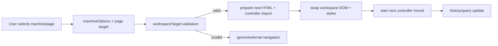
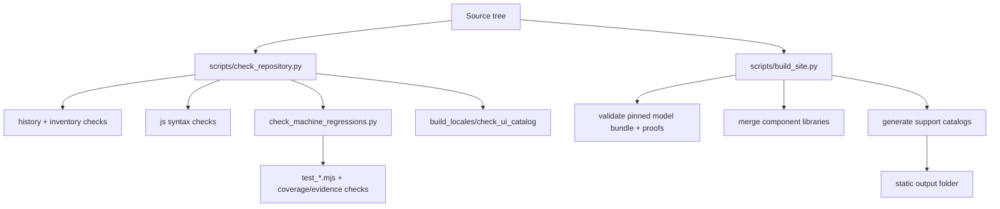

# Architecture Review (Phase 2)

## Scope

This review reverse-engineers the current baseline architecture for:

- runtime rendering and interaction
- routing and workspace navigation
- data and compatibility composition
- URL/share state behavior
- translation system
- build and deployment pipeline
- generated support-content pipeline

## Runtime architecture (viewer)

The viewer runtime is a static-module application bootstrapped per page controller:

- entry pages choose a controller module (`app.js`, `v24-app.js`, `community.js`, etc.)
- controller mounts a Three.js scene and UI controls
- domain modules compose compatibility and machine/head behavior
- workspace router supports in-page transitions between machine pages

### Runtime architecture diagram

```mermaid
flowchart TD
  A[HTML page + data-controller] --> B[workspace-router.mjs]
  B --> C[controller mount()]
  C --> D[Three.js scene + GLTF loader]
  C --> E[configuration/compatibility modules]
  C --> F[i18n + display preferences]
  C --> G[workspace URL sync]
  E --> H[catalog JSON + module manifests]
  D --> I[pinned model bundle assets]
```

## Rendering logic

Primary rendering flow:

1. resolve machine context (`siboorMachine()` and page-specific selectors)
2. initialize Three.js renderer/camera/orbit controls
3. load stock model + optional modular assets via `loadModel`/module loaders
4. apply visibility/material/motion transforms per selected configuration
5. sync accessory modules, toolchanger state, belts/chains, and status panels

Characteristics:

- rendering and domain state are tightly integrated in controller modules
- modular asset loading is dynamic and cache-aware
- progress/hash checks are incorporated in model loading paths

## Routing and navigation

Routing is split between:

- machine selector logic (`machines.js`)
- workspace-safe link targeting (`workspace-navigation.mjs`)
- in-place page transitions (`workspace-router.mjs`)

Navigation behavior:

- validates allowed workspace pages
- preloads next template/module
- preserves interaction context where possible
- updates history and query state using guarded `replaceState`/`pushState`

### Navigation flow diagram



## Data structures and compatibility system

Compatibility is largely data-driven through JSON catalogs and registration maps:

- machine/head/toolhead/gantry catalogs
- accessory/mod registration and constraints
- variant compositions generated by scripts
- support index generated from the same composition logic used by runtime

Key runtime selection model:

- `configuration-model.js` resolves best variant by dimensions and constraints
- candidate evaluation prefers installed, compatible combinations
- probe/mount/carriage constraints are integrated into scoring/selection

## URL generation and state transfer

Primary URL state:

- `machine` and page selection
- `configuration` identifiers
- optional mount/gantry/query overrides
- `lang`, `embed`, and theme controls

Behavior:

- URL is treated as a first-class share state
- unsupported embedded states fail explicitly rather than silently degrading
- workspace transitions avoid stale URL overwrites

## Translation mechanisms

Translation stack:

- source definitions + locale dictionaries compiled by `scripts/build_locales.mjs`
- runtime translation engine (`translation-engine.mjs`)
- DOM mutation-aware relocalization (`i18n.mjs`)
- locale loading on-demand with language persistence

Validation:

- `scripts/check_ui_catalog.mjs` detects untranslated Japanese literals / unknown IDs
- dictionary checks enforce placeholders, numeric values, protected terms, and stale revisions

## Build architecture

### Build architecture diagram



## Deployment pipeline

GitHub workflows:

- `source-check.yml` runs source gate checks on push and PR
- `pages.yml` performs check + build + GitHub Pages deployment on `main`

## Architectural strengths

1. data-driven compatibility composition with scriptable generation
2. strict publication integrity and provenance controls
3. static runtime with robust shareable URL/state model
4. mature internationalization workflow with compile-time validation

## Architectural risks

1. page-controller modules are large and multi-responsibility
2. feature boundaries are not explicit at folder level
3. runtime contracts are mostly informal JSON shape agreements
4. testing is strong for regressions but weaker for unit-level business logic isolation
