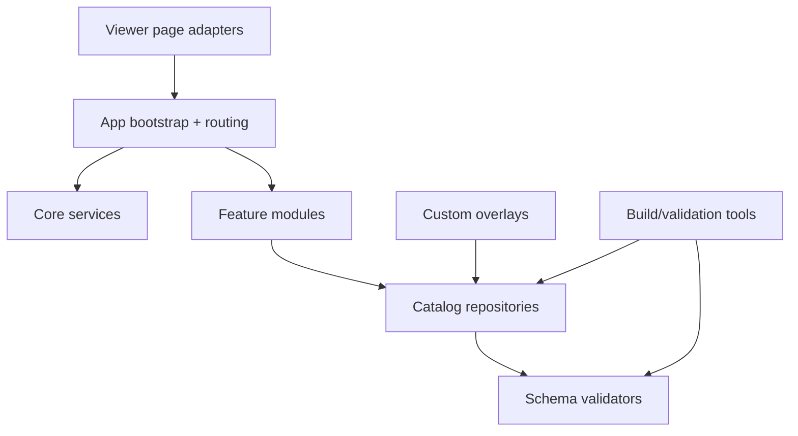

# Target Architecture (Phase 4)

## Objectives

Design a long-lived architecture for owner-operated evolution with:

- feature-first organization
- strong separation of concerns
- explicit extension points for custom content
- upstream-sync-friendly boundaries
- testable domain logic

## Proposed folder architecture

```text
src/
  app/
    bootstrap/
    routing/
    workspace/
  core/
    rendering/
    assets/
    i18n/
    navigation/
    persistence/
  features/
    printers/
    toolheads/
    hotends/
    probes/
    electronics/
    canbus/
    accessories/
    mods/
    compatibility/
    support-index/
  shared/
    types/
    schema/
    utils/
    ui/
  adapters/
    viewer-pages/
    github-pages/
    importers/
data/
  catalogs/
  machines/
  manifests/
custom/
  catalogs/
  machines/
  overlays/
tools/
  build/
  validation/
  migration/
docs/
```

## Architectural principles

1. **Feature modules own business rules**  
   Compatibility and variant composition live in `features/compatibility`, not page controllers.

2. **Core is framework-agnostic runtime plumbing**  
   Rendering, navigation, and i18n services exposed through explicit interfaces.

3. **Adapters isolate entrypoint/platform specifics**  
   Existing `site/viewer/*.html` pages become thin adapters to app bootstrap.

4. **Data is validated at boundaries**  
   JSON schema + runtime guards at load/build time.

5. **Custom layer is additive and mergeable**  
   `custom/` overlays merged through deterministic precedence rules.

## Logical layers



## Module contracts (target)

- `features/*/domain.ts`: pure business rules
- `features/*/repository.ts`: read/query normalized data
- `features/*/presenter.ts`: UI-ready projection models
- `core/*`: infrastructure services (rendering, navigation, i18n)
- `adapters/*`: page glue code only

## Compatibility engine target

Move current selection/scoring logic into:

- `features/compatibility/rules/` (declarative predicates)
- `features/compatibility/solver/` (candidate resolution/scoring)
- `features/compatibility/tests/` (deterministic fixture tests)

## Data strategy target

- canonical catalogs under `data/catalogs/`
- generated artifacts clearly separated from source definitions
- schema versioning + migration scripts
- extension overlay merge order:
  1. core catalogs
  2. upstream update patches
  3. owner `custom/` overlays

## Testing strategy target

- unit tests: compatibility solver, URL/state parsing, translation transforms
- integration tests: page adapter + runtime wiring
- regression tests: existing machine evidence and publication checks
- content validation tools under `tools/validation/`

## Non-goals

- no immediate rewrite of Three.js rendering internals
- no migration to heavyweight frontend framework unless required by measurable complexity reduction
